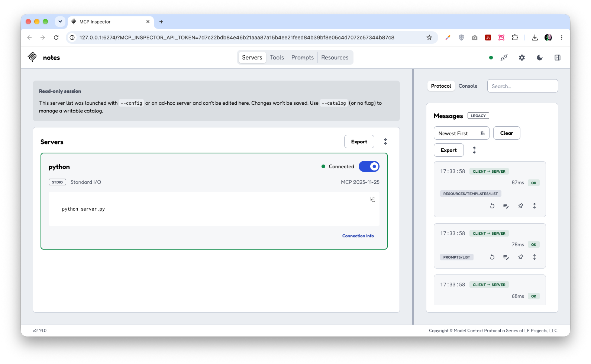
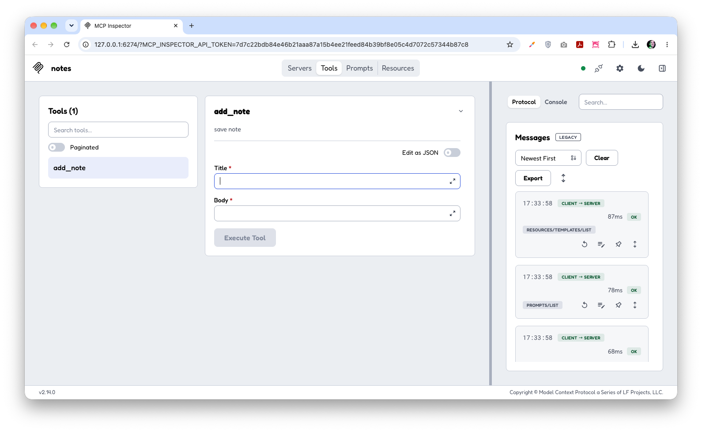

# My first MCP

## Setup and test

Run the service with

```bash
python -m venv .venv
source .venv/bin/activate
pip install -r requirements.txt
npx @modelcontextprotocol/inspector python server.py
```

This library allow us to test the mcp server, providing ways to connect, see the tools list, and even call some tool.

**Connect**



**Tools**



## Use it from Claude Code

Register the server (run from this folder, so the paths resolve):

```bash
claude mcp add notes -- "$(pwd)/.venv/bin/python" "$(pwd)/server.py"
claude mcp get notes   # Status: ✔ Connected
```

It's saved in local scope (private to you, only in this project). Remove it with `claude mcp remove notes -s local`.

Then start a new Claude Code session in this folder and try:

- `save a note called groceries: eggs, milk` → calls the `add_note` tool
- `search my notes for milk` → calls the `search_notes` tool
- `/mcp` → shows the server, its tools, resource (`notes://all`) and prompt
- the `summarize_notes` prompt shows up as a slash command

Claude decides which tool to use from its docstring, so clear descriptions matter.

### What the server exposes

| Primitive | Name | What it does |
|---|---|---|
| Tool | `add_note(title, body)` | Appends a note to `notes.json` |
| Tool | `search_notes(query)` | Case-insensitive search in title and body |
| Resource | `notes://all` | Raw contents of `notes.json` |
| Prompt | `summarize_notes` | Asks for a 3-bullet summary of all notes |
