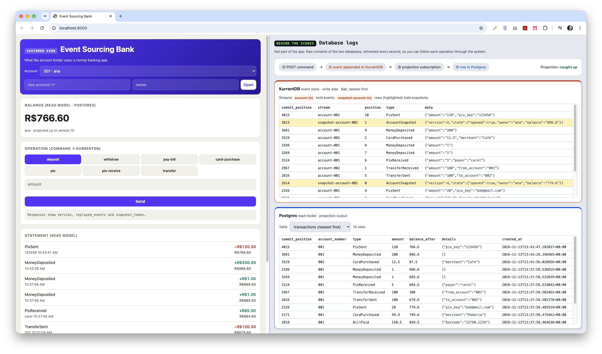
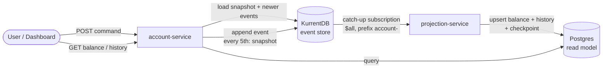

# Event Sourcing POC — bank account





- **Write side**: each account is a stream `account-{n}`. Commands load state from the latest
  snapshot + events after it, validate, and append with optimistic concurrency (409 on conflict).
- **Snapshots**: every `SNAPSHOT_EVERY` (5) events, state is written to `snapshot-account-{n}`
  (`$maxCount=1`, so only the latest is kept). The response's `replayed_events` shows how many
  events were replayed — it drops to 0 right after a snapshot.
- **Read side**: projection writes `accounts` (balance) and `transactions` (history) to Postgres,
  storing the `$all` commit position as a checkpoint in the same transaction.

Events: `AccountOpened`, `MoneyDeposited`, `MoneyWithdrawn`, `BillPaid`, `CardPurchased`,
`PixSent`, `PixReceived`, `TransferSent`, `TransferReceived`.

## Run

```bash
docker compose up -d --build --wait
# Intel/amd64: KURRENTDB_IMAGE=kurrentplatform/kurrentdb:26.0.4 docker compose up -d --build --wait
```

**Dashboard: http://localhost:8000** (left: fake bank app; right: live dump of KurrentDB and Postgres, polled every 1s, new rows flash)

KurrentDB UI: http://localhost:2113 · API docs: http://localhost:8000/docs · read DB: `localhost:5440` (rd/rd)

```bash
A=http://localhost:8000/accounts; H='content-type: application/json'
curl -XPOST $A -H "$H" -d '{"account_number":"001","owner":"ana"}'
curl -XPOST $A -H "$H" -d '{"account_number":"002","owner":"bob"}'
curl -XPOST $A/001/deposit       -H "$H" -d '{"amount":1000}'
curl -XPOST $A/001/withdraw      -H "$H" -d '{"amount":50}'
curl -XPOST $A/001/pay-bill      -H "$H" -d '{"amount":150.5,"barcode":"23790.1234"}'
curl -XPOST $A/001/card-purchase -H "$H" -d '{"amount":49.9,"merchant":"Padaria"}'
curl -XPOST $A/001/pix           -H "$H" -d '{"amount":20,"pix_key":"bob@mail.com"}'
curl -XPOST $A/001/pix-receive   -H "$H" -d '{"amount":5,"payer":"carol"}'
curl -XPOST $A/001/transfer      -H "$H" -d '{"amount":100,"to_account":"002"}'
curl $A/001            # balance (from Postgres)
curl $A/001/history    # statement (from Postgres)
```

Domain self-check: `cd account-service && python3 test_domain.py`
